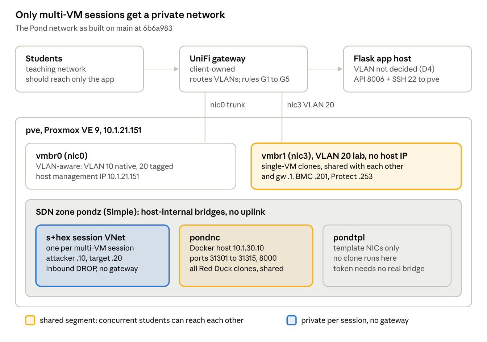

# The Pond — Proxmox, VMID and Network Reference

Written 8 Oct 2026 by Lochlan Hardie; checked on 21 Oct 2026 against `main` at `04998a1` with `fix/seeder-theme-flagformat` (`3dc6afc`) merged

## 1. Purpose and scope

This is the operating reference for The Pond's Proxmox host, VMID allocation and network: what is configured, why, and how to rebuild it on a bare host. It is written for the sysadmin who runs the platform.

**Source of truth.** Behaviour described here was read from the application code on `main` at commit `6b6a983`, re-checked against `04998a1`, and then against `04998a1` with the branch `fix/seeder-theme-flagformat` merged. That branch's commit `4476c02` ("isolate every launch") changed the isolation model: every section below describes the merged code. Until the branch is merged, `main` still behaves as the 8 Oct version of this document described, with only multi-VM sessions isolated. Files read: `provisioner.py`, `pond-sec/app/themes.py`, `pond-sec/app/proxmox.py`, `pond-sec/app/config.py`, `import_challenge.py`, `db/init_database.py`, `playbooks/pond_least_privilege.yml` and `vars/challenges/*.yml`. Values that only the live host can prove are marked **VERIFY**; §10.3 lists the commands that confirm them. Where the host and this document disagree, the host is what runs: update the document.

**Terms.**

- *Template*: a Proxmox VM template that challenge sessions are cloned from.
- *Session*: one student's launch of one challenge (a `ChallengeInstance` row).
- *Red Duck*: the `Kali-attacker` template, VMID 10001, used as the attacker or tool workstation.
- *Container lab*: a challenge served from the shared Docker host and solved from a Red Duck clone.

**Out of scope.** The upstream UniFi gateway and switches belong to the site network owner. This document states what The Pond requires of them (§7.5), not how they are configured.

## 2. Proxmox host and VMID reference

The Pond runs on one Proxmox VE 9 node, `pve`, and drives it through a single least-privilege API token. Every session VM is a linked QEMU clone of a template, numbered from one fixed range: **304–399**.

### 2.1 Host

| Item | Value | Source |
| --- | --- | --- |
| Node | `pve`, single node, no cluster | `config.py` `PROXMOX_NODE` |
| Version | Proxmox VE 9 on Debian 13 (Trixie) | host records — VERIFY `pveversion` |
| Management address | `10.1.21.151/24`, gateway `10.1.21.1` | `config.py` `PROXMOX_HOST` |
| Hardware | 2× Xeon E5-2698 v4 (80 threads, 2 NUMA nodes), 755 GiB RAM | host records |
| Storage | `local-lvm`, LVM-thin in volume group `pve`, \~612 GiB usable; holds templates and clones | `config.py` `PROXMOX_STORAGE`; `vg_name="pve"` is hard-coded in `inject_instance_network()` |
| Repositories | `pve-no-subscription`; `pve-enterprise` and `ceph` sources disabled | §8 Phase 1 |
| Extra package | `libguestfs-tools` (provides `virt-customize`) | §8 Phase 1 |

### 2.2 Guests and cloning

- **QEMU only.** Every call uses `/nodes/<node>/qemu/…`. LXC templates are not supported: `_resolve_template_vmid()` searches only the QEMU tree.
- **Linked clones by default** (`PROXMOX_FULL_CLONE=0`). A clone shares its template's disk, so it is created in seconds, but the template cannot be removed while its linked clones exist ([Proxmox admin guide, Copies and Clones](https://pve.proxmox.com/pve-docs/chapter-qm.html#qm_copy_and_clone)). `PROXMOX_FULL_CLONE=1` copies the disk to `PROXMOX_STORAGE` instead.
- **Disk injection before boot.** When a challenge sets a static IP, the app writes `/etc/network/interfaces` for interface `eth0` into the stopped clone's disk with `virt-customize`; Red Duck clones also get a first-boot command that downloads handouts (`inject_instance_network()`, `inject_firstboot_command()`). Templates that need a static IP must therefore use ifupdown and name their NIC `eth0`.
- **Clone names** are `<username>-<challenge_id>-<role>`, cut to 63 characters (`themes.py` line 441).

### 2.3 Pools, identity and permissions

`playbooks/pond_least_privilege.yml` creates two pools and one token. The app checks the token's effective rights before every launch and refuses to launch if it holds anything outside this table (`_check_token_privileges()` in `pond-sec/app/proxmox.py`).

| ACL path | Role | Privileges |
| --- | --- | --- |
| `/pool/pond-clones` | PondClones | VM.Allocate, VM.Audit, VM.Config.Network, VM.PowerMgmt, VM.Console, Pool.Audit |
| `/pool/pond-templates` | PondTemplates | VM.Audit, VM.Clone, Pool.Audit |
| `/sdn/zones/pondz` | PondSDN | SDN.Allocate, SDN.Audit, SDN.Use |
| `/sdn` (no propagation) | PondSDNApply | SDN.Allocate |
| `/` (no propagation) | PondAudit | Sys.Audit |
| `/storage/local-lvm` | PondStorage | Datastore.AllocateSpace |
| `/sdn/zones/localnetwork/<bridge>` | PondBridge | SDN.Use — only for bridges listed in `pond_template_bridges` (none by default) |
| `/sdn/zones/<zone>/<vnet>` | PondBridge | SDN.Use — only if the playbook's `pond_workstation_vnet` is set (empty by default; for a future VLAN-backed `pondnc`, §5.4). The app accepts it only when `PROXMOX_WORKSTATION_ZONE` names the same zone |

- **Identity:** user `pond@pve`, privilege-separated token `pond@pve!launcher`. Each grant is given to both, so the token holds the intersection. `@pam` tokens are refused by the app.
- **Never granted** (checked again after the playbook runs): Permissions.Modify, Sys.Modify, VM.Config.Disk/CPU/Memory, VM.Snapshot, VM.Backup, VM.Migrate and others listed in `pond_forbidden_privileges`.
- **Consequence:** the token sees only VMs in the two Pond pools. This matters for VMID allocation (§2.6).
- **Second credential:** a root SSH key from the app host to `pve`, used only for `virt-customize`. It is more powerful than the token (§7.3).

### 2.4 Templates

Templates are referenced by **name** in `vars/challenges/*.yml` and resolved to a VMID once, when `db/init_database.py` seeds the database (`_resolve_template_vmid()` returns the first QEMU VM on the node with that exact name). The stored VMID is used from then on. Renaming a template, or creating a second VM with the same name before seeding, changes which VM gets cloned.

| VMID | Name | Role | Used by |
| --- | --- | --- | --- |
| 10000 | Metasploitable 2 | target | `metasploitable2` |
| 10001 | `Kali-attacker` (Red Duck) | attacker / tool workstation | `dc1`, `kioptrixlevel1`, and 47 single-VM Red Duck challenges |
| 10002 | `DC-1` | target | `dc1` |
| VERIFY | `Kioptrix-Level-1` | target | `kioptrixlevel1` |
| VERIFY | `VM 10000` | target | `lockedshields` |

Rules a template must meet before the playbook will accept it: it is a template; it sits in no pool other than `pond-templates`; every disk is on `local-lvm`; no host CD-ROM; every NIC is on a VNet in `pondz` or on a bridge listed in `pond_template_bridges` (playbook pre-flight tasks).

**Adding a template.** Import with `import_challenge.py` (allocates the next free VMID in 10000–10999); move its NIC off `vmbr0` (§8 Phase 5); re-run the playbook with the new VMID in `pond_template_vmids` so it joins `pond-templates`; reference it by name in the challenge YAML; re-seed.

### 2.5 VMID ranges

| Range | Holds | Allocated by | Enforced by |
| --- | --- | --- | --- |
| 300–303 | Another project's VMs. Never cloned, started, stopped or deleted by The Pond | — | `PROTECTED_VMIDS` in `provisioner.py` (hard-coded) and `PROXMOX_PROTECTED_VMIDS` in the app config |
| 304–399 | Every live session clone, all challenges | `claim_vmid()`, from `DEFAULT_VMID_RANGE = (301, 399)` minus 300–303 | Code |
| 10000–10999 | Challenge templates | `import_challenge.py` (`TEMPLATE_VMID_START`/`_END`) | That importer only; the upload pipeline and `db/register_template.py` accept any VMID from 100 to 999,999,999 |
| Everything else | Not used by The Pond | — | — |

**Present in config but not used.** Do not tune these; they change nothing.

- `vmid_range_start` / `vmid_range_end` in `vars/challenges/*.yml` (for example 1301–1399 in `dc1.yml`). Neither `db/init_database.py` nor the web app reads them; only the legacy `debugger-app.py` does. All challenges draw from 304–399.
- `PROXMOX_CLONE_POOL_START` (default 9000) in `pond-sec/app/config.py`. Nothing reads it.

### 2.6 How a clone gets its VMID

1. `launch()` calls `clone_and_start()` without a `vmid_range`, so the default 301–399 applies.
2. `claim_vmid()` builds the used set: QEMU and LXC VMIDs the token can see on the node, every `VMInstance` row with `deleted_at` empty, and 300–303.
3. It walks 301→399 and inserts a `VMInstance` row (`status='reserving'`) for the first free number. A partial unique index on `proxmox_vmid WHERE deleted_at IS NULL` (`db/runtime_models.py`) is the actual lock: if two launches pick the same number, one commit fails and that launch moves to the next number.
4. The clone is created with that VMID in pool `pond-clones`. If cloning fails, the row is marked `error` with `deleted_at` set, which frees the number. On teardown, `stop_and_destroy()` marks the row `destroyed` and sets `deleted_at`.

**Blind spot.** The token sees only VMs in the Pond pools. A VM created by anyone else in 304–399 is invisible to step 2, so its number gets picked and the clone fails with "already exists". The row is then released, so the next launch picks the same number again: a stray VM blocks every launch for as long as it is the lowest free number.

### 2.7 Capacity

The range holds 96 VMIDs (304–399) shared by all challenges. A single-VM session uses one; a `dc1` session uses two. The ceiling is therefore 96 concurrent single-VM sessions, or 48 concurrent `dc1` sessions, or a mix. The next launch fails with `no free VMIDs in range 301-399`. RAM or `local-lvm` space may run out first; neither has been measured under load.

### 2.8 Operating rules

- **Keep 300–399 and 10000–10999 for The Pond.** Never create VMs there by hand (§2.6 blind spot).
- **Changing the protected list** means three edits that must agree: `PROTECTED_VMIDS` in `provisioner.py`, `PROXMOX_PROTECTED_VMIDS` in the app environment, and `pond_protected_vmids` in the playbook. Allocation (`claim_vmid()`) honours only the hard-coded set; the environment variable guards the app layer (template, console and teardown calls).
- **Changing the clone range** is a code change: edit `DEFAULT_VMID_RANGE` in `provisioner.py`. No setting controls it. Keep the new range clear of 300–303 and of the template range.
- **Orphaned clones.** A clone left behind after a crash still occupies its VMID and stays excluded from allocation. Compare `pond-clones` members against running sessions in the app, then destroy the stray with `qm stop <vmid>` and `qm destroy <vmid>` ([qm(1)](https://pve.proxmox.com/pve-docs/qm.1.html)). Never destroy a VMID in 300–303.
- **Inspecting state** ([pvesh(1)](https://pve.proxmox.com/pve-docs/pvesh.1.html), [API viewer](https://pve.proxmox.com/pve-docs/api-viewer/)):

```bash
pvesh get /cluster/resources --type vm --output-format json   # every VM, its pool and status
pvesh get /pools/pond-clones --output-format json             # live session clones
pvesh get /pools/pond-templates --output-format json          # templates students can clone
qm list                                                       # VMIDs on this node
```

## 3. Architecture overview

The Pond has three trust zones: the management plane (VLAN 10), the shared lab LAN (VLAN 20), and host-internal SDN VNets that never leave the Proxmox box. Students should only ever touch the Flask app; challenge VMs should only ever touch their own segment.



The diagram predates the merge. Its amber marks two places students shared a segment: single-VM clones on `vmbr1`, and every Red Duck clone on `pondnc`. After the merge only the second remains, and those clones are now firewalled from each other (§5.2). Bridge-to-NIC mapping and `pondtpl` are **VERIFY** items (§10.3).

### 3.1 From launch to served

The student's browser only ever talks to the Flask app. The app builds the session's network through the Proxmox API and root SSH while the clone is still powered off, then relays the console. Only after boot does traffic flow inside the range itself: the clone to the Docker host or to its target VM.

| # | What happens and why | Network path | Code |
| --- | --- | --- | --- |
| 1 | Student clicks Launch. The app checks the challenge is published and the student has no other session running, then writes a `ChallengeInstance` row (`provisioning`) | Browser → app, HTTPS, `POST /themes/challenges/<id>/launch` | `themes.launch()` |
| 2 | The app confirms its token holds nothing beyond §2.3, and refuses to launch if it does. Cached for `PROXMOX_PRIVILEGE_CHECK_TTL` (300 s). Then, on every clone, it confirms `pondz` is a Simple zone and the datacenter firewall is on, and refuses otherwise | App → `10.1.21.151:8006`, `GET /access/permissions`, `GET /cluster/resources`, `GET /cluster/sdn/zones`, `GET /cluster/firewall/options` | `_check_token_privileges()`, `check_isolation_preconditions()` |
| 3 | **Every launch except a lone Red Duck** (§5). Create VNet `s<hex instance_id>` in `pondz`, then apply SDN so the host builds the bridge. If Proxmox refuses, the launch stops here and the reason is logged | `POST /cluster/sdn/vnets`, `PUT /cluster/sdn` | `create_session_vnet()` |
| 4 | Reserve a VMID in 304–399 (§2.6) and linked-clone the template into pool `pond-clones`; wait for the clone task | `GET /nodes/pve/qemu`, `/lxc`; `POST /nodes/pve/qemu/<template>/clone`; task polling | `claim_vmid()`, `clone_and_start()` |
| 5 | With the clone still off, write into its disk: a static `/etc/network/interfaces` if the challenge sets an IP (never with a gateway now: launch no longer passes one), and for Red Duck a first-boot command that fetches handouts | App → `10.1.21.151:22` as root: SFTP to `/tmp`, then `virt-customize -a /dev/pve/vm-<vmid>-disk-0` | `inject_instance_network()`, `inject_firstboot_command()`, `_handout_command()` |
| 6 | Every NIC (`net0`, `net1`, …) gets `firewall=1`; with a session VNet, each also moves onto it with any `tag=` and `trunks=` removed. The config is read back and the launch refused if any NIC didn't take. Then the VM firewall is switched on with `policy_in=DROP`; a lone Red Duck also gets `policy_out=DROP`, DHCP allowed, and its outbound allowlist (§5.2) | `GET`/`PUT /nodes/pve/qemu/<vmid>/config`; `POST`/`GET …/firewall/rules`; `PUT …/firewall/options` | `_firewall_nics()`, `enable_vm_firewall()` |
| 7 | Boot the clone. Steps 4–7 repeat for each VM in the challenge | `POST /nodes/pve/qemu/<vmid>/status/start` | `clone_and_start()` |
| 8 | **Multi-VM only.** After every VM is up: one inbound ACCEPT (enabled) per `network_rules` entry on the destination VM | `POST …/firewall/rules` | `apply_network_rule()` |
| 9 | Session marked `running`; the student is redirected to the challenge page | App → browser, 302 | `themes.launch()` |
| 10 | Student opens the console. The app checks they own the session | Browser → app, `GET /themes/session/<id>/console` | `themes.console()` |
| 11 | The app asks Proxmox for one VNC ticket and port, and embeds them in the page | App → `:8006`, `POST /nodes/pve/qemu/<vmid>/vncproxy` (`websocket=1`) | `get_console_ticket()` |
| 12 | noVNC in the browser opens a WebSocket back to the app, carrying the ticket | Browser → app, `WSS /themes/session/<id>/console/ws?ticket=…&port=…` | `static/js/console.js` |
| 13 | The app opens the upstream socket with its token and pumps frames both ways | App → `wss://10.1.21.151:8006/api2/json/nodes/pve/qemu/<vmid>/vncwebsocket` | `themes.console_relay()` |
| 14 | Proxmox connects that socket to the VM's QEMU display. This is not the guest's network, which is why the console still works on a VNet with no gateway | Inside `pve` | Proxmox |
| 15 | **Red Duck only.** On first boot Red Duck downloads its handouts to `/home/kali/Desktop/<challenge>` (10 tries, 3 s apart) | Clone → `http://10.1.30.10:8000/<challenge>/` over `pondnc` | `_handout_command()` |
| 16 | The student works the challenge from inside the VM: Red Duck to a container port, or Kali to its target on the ports `network_rules` allow | `10.1.30.10:31301–31315` over `pondnc`; or `10.10.10.10 → 10.10.10.20` inside the session VNet | `vars/challenges/*.yml` |
| 17 | Flags go back through the browser, never from the VM | Browser → app, `POST /themes/session/<id>/flag` | `themes.flag()` |
| 18 | On close: stop and delete each VM, and with the last one delete the VNet and apply SDN again | `POST …/status/stop` (awaited), `DELETE /nodes/pve/qemu/<vmid>`, `DELETE /cluster/sdn/vnets/<vnet>`, `PUT /cluster/sdn` | `themes._close()`, `stop_and_destroy()` |

**What this means for operations:**

- **Step 3 and step 18 apply SDN for the whole node.** `PUT /cluster/sdn` applies every pending SDN change, not just this session's VNet. A half-finished SDN edit left pending in the GUI goes live on the next launch or close that uses a session VNet, which is now almost every launch.
- **Filtering is in place before boot; the allow rules arrive after.** Between steps 7 and 8 the VMs of a multi-VM session can't reach each other at all (inbound DROP, no rules yet). A failure at step 8 isn't caught by the launch's error handling and leaves the session stuck in `provisioning` ([known issues](../known-issues.md) L14).
- **Turning the datacenter firewall off stops every launch.** Step 2 refuses with "the datacenter firewall is disabled, so VM firewalls would not apply". Sessions already running are unaffected.
- **Step 5 is the only root path from the app to the host.** If SSH to `pve` fails, launches that need a static IP or handouts fail; launches that need neither still work.
- **Step 15 fails quietly.** If the clone cannot reach `10.1.30.10` (for example a Red Duck attacker inside a multi-VM session VNet, [known issues](../known-issues.md) N9), `wget` gives up after its retries and the student's Desktop has no handouts. Nothing reports the failure to the app.
- **Step 18 does not wait for the VM delete** before deleting the VNet (`destroy_instance()` awaits the stop, not the delete). Check for leftover `s…` VNets with test N12.

## 4. Addressing, VLAN, bridge and SDN plan

The Pond uses three address spaces, and they do different jobs: VLAN 10 is the management plane, VLAN 20 is the shared lab LAN, and SDN VNets are private per-session or per-service segments that exist only inside the Proxmox host.

### 4.1 Host and physical layer

| Item | Value | Source |
| --- | --- | --- |
| Management IP | `10.1.21.151/24`, gateway `10.1.21.1` | `config.py` `PROXMOX_HOST` |
| NIC → bridge | `nic0` → `vmbr0` (VLAN-aware; native VLAN 10, also carries tagged frames); `nic3` → `vmbr1` (VLAN 20, no host IP) | host records — VERIFY `cat /etc/network/interfaces` |
| Inter-VLAN routing | Upstream UniFi gateway, not Proxmox | host records |

### 4.2 Networks

| Network | Subnet | Gateway | Carried by | Who lives there | Source |
| --- | --- | --- | --- | --- | --- |
| VLAN 10, management | `10.1.21.0/24` | `10.1.21.1` | `vmbr0` untagged | Proxmox host, admin/control nodes | `config.py` |
| VLAN 20, lab | `10.1.20.0/24` | `10.1.20.1` (confirmed by test) | `vmbr1`, or `vmbr0` tag 20 — **VERIFY which** | No challenge clones since the merge (every target goes onto a session VNet). The server BMC `10.1.20.201` and UniFi Protect `10.1.20.253` | Host records. `PROXMOX_LAB_GATEWAY` in `config.py` is no longer read |
| SDN zone `pondz` | Simple zone, no subnets | none | Host-internal bridges | Container for per-session VNets | `provisioner.py` `VNET_ZONE`; `config.py` |
| Session VNets `s<hex instance_id>` | none defined; guests use `10.10.10.0/24` statics from challenge YAML | none, by design | One bridge per session (every launch except a lone Red Duck) | The clones of one session: attacker + target, or a single target alone | `provisioner._session_vnet_name()`; `vars/challenges/dc1.yml` |
| VNet `pondnc` | guests use `10.1.30.0/24` (Docker host `.10`) | **VERIFY**: whether a subnet/gateway/SNAT is defined | Host-internal bridge | Docker challenge host; every lone Red Duck clone (the Docker-hosted challenges) | `tools/gen_bsides_challenges.py` line 16 |
| VNet `pondtpl` (recommended) | none | none | Host-internal bridge | Template NICs only, so the token needs no grant on a real bridge | `pond_least_privilege.yml` header — **VERIFY** whether created |

Why `10.10.10.x` can repeat across sessions: each session VNet is its own broadcast domain, so two sessions both using `10.10.10.10` never see each other (`create_session_vnet()` docstring). The same address on the shared VLAN 20 *would* collide.

### 4.3 Session VNet naming

VNet IDs are `s` + the `ChallengeInstance` id in hex (instance 255 → `sff`). Proxmox limits VNet IDs to 8 characters because the ID becomes a Linux bridge interface name ([Proxmox SDN docs, VNets](https://pve.proxmox.com/pve-docs/chapter-pvesdn.html)); `VNET_ID_RE` enforces this, so the scheme runs out at instance `0xfffffff` (268 million).

## 5. Isolation model by challenge type (as built)

Since the merge, **every VM launch is isolated**. The rule is in `themes.launch()` (lines 416–433):

- If the challenge is `execution_type: container_lab`, or it has exactly one VM and that VM's template is named `POND_HANDOUT_TEMPLATE` (`Kali-attacker`), the launch is a **lone Red Duck**. The clone stays on its template's network, `pondnc`, because it has to reach the Docker host, and a session VNet with no gateway can't. It is isolated by its own VM firewall instead (§5.2).
- Every other launch, single- or multi-VM, gets its own session VNet, and every clone of that session goes onto it.

In both cases `clone_and_start()` turns on the firewall on every NIC and on the VM **before it boots**, and every launch first checks that the datacenter firewall is on and that `pondz` is a Simple zone (`check_isolation_preconditions()`), refusing otherwise.

| Challenge type | Purpose of the VM | Challenges | Network a clone lands on | Firewall | Isolated from other students? |
| --- | --- | --- | --- | --- | --- |
| Multi-VM | Kali = red-team attacker; target = the challenge | `dc1`, `kioptrixlevel1` | New session VNet `s<hex>` in `pondz` | `policy_in=DROP` on every VM + one ACCEPT per `network_rules` entry | **Yes**, at L2 |
| Lone Red Duck | Red Duck = tools to solve a challenge on the Docker host | 47 challenges (`curveball`, `dockjmp`, …) | Template `10001` `Kali-attacker`'s bridge, `pondnc` — **VERIFY** | `policy_in=DROP`, `policy_out=DROP` + outbound allowlist (§5.2) | **Yes**, by firewall; still one shared L2 segment |
| Single-VM target | The VM *is* the challenge; no attacker VM | `metasploitable2`, `lockedshields` | New session VNet, alone | `policy_in=DROP` | **Yes**, and unreachable over the network at all (§10.1 L2) |
| Offline | No VM | none loaded at present | n/a | n/a | n/a |

### 5.1 Why session VNet isolation works

1. `create_session_vnet()` posts a VNet to the Simple zone and applies SDN (`client.cluster.sdn.put()`). A Simple zone VNet is a host-internal bridge "not linked to a physical interface" ([Proxmox SDN docs, Simple Zones](https://pve.proxmox.com/pve-docs/chapter-pvesdn.html)), so frames on it cannot leave the host.
2. No subnet is defined, so Proxmox puts no gateway address on that bridge. The host itself is therefore not an L3 neighbour of the guests.
3. Before the first boot, `_firewall_nics()` rewrites every `netN` to `bridge=<vnet>`, strips `tag=` and `trunks=`, adds `firewall=1`, then reads the config back and refuses the launch if any NIC is wrong. The guest never touches VLAN 20.
4. Still before boot, `enable_vm_firewall()` sets `enable=1`, `policy_in=DROP`. After all clones are up, `apply_network_rule()` adds one enabled ACCEPT per YAML rule on the destination VM.

### 5.2 Lone Red Duck: shared segment, firewalled

**Design decision (8 Oct 2026, revised by `4476c02`).** Red Duck clones for Docker-hosted challenges still share `pondnc`, because they all need the Docker host. On 8 Oct that was an accepted risk with no firewall at all. Since the merge, each clone gets a VM firewall that stops it talking to the others. The rules, top to bottom, first match wins (`themes._workstation_egress()`):

| # | Direction | Rule | When |
| --- | --- | --- | --- |
| — | in | DROP everything (`policy_in`) | Always |
| 1 | out | ACCEPT TCP to `POND_DOCKER_HOST_IP` (`10.1.30.10`): handouts on 8000, challenges on 31301 and up | Always |
| 2 | out | ACCEPT UDP and TCP port 53 to anywhere (DNS) | Only if `POND_WORKSTATION_INTERNET_PORTS` is set |
| 3 | out | DROP `10.0.0.0/8, 172.16.0.0/12, 192.168.0.0/16, 100.64.0.0/10, 169.254.0.0/16` | Always |
| 4 | out | ACCEPT TCP to anywhere on `POND_WORKSTATION_INTERNET_PORTS` (default `80,443`) | Only if that setting is set |
| — | out | DROP everything else (`policy_out`); DHCP allowed (`dhcp=1`) | Always |

The rules are written with comments `pond-egress-0`, `pond-egress-1`, …, read back, and the launch refused if Proxmox stored them out of order (`enable_vm_firewall()`).

**What this does and doesn't cover:**

- Red Duck can't open a connection to another student's Red Duck, the hypervisor, the management VLAN or VLAN 20 (rule 3). Inbound DROP stops the reverse direction.
- It can still send forged ARP on the shared segment, for example claiming to be `10.1.30.10`: the code doesn't set `ipfilter` or `macfilter` (§6.4). That can cut other students off from the Docker host. The spoofer's own inbound DROP should stop it reading the redirected traffic, but this hasn't been tested.
- One student crashing a shared challenge container still affects everyone using it. That's inherent to the shared Docker host.
- **No internet in practice.** Rules 2 and 4 let DNS and web traffic out, but `pondnc` has no routed uplink (§7.4), so nothing gets there. Set `POND_WORKSTATION_INTERNET_PORTS=""` to remove those rules altogether.
- The Docker host is outside the app's control and must still be blocked from reaching anything but `pondnc` (see [`deployment/docker-host/`](../../deployment/docker-host/README.md)).

### 5.3 Single-VM targets

A single target (Metasploitable 2) now sits on a session VNet with nothing else on it. That isolates it completely, including from the student: the only way in is the VM's console. To make such a challenge attackable, give it a `Kali-attacker` with a static IP and `network_rules`, as `dc1.yml` does. It then launches as a normal multi-VM session (§10.1 L2).

### 5.4 Routing Red Duck to the internet (prepared, not built)

The branch prepares, but doesn't build, a routed `pondnc`: a VLAN-backed VNet in a second zone, with an upstream gateway providing DHCP, DNS and NAT. The pieces in the code:

- `PROXMOX_WORKSTATION_ZONE` (app setting, default empty) names that zone. The privilege check then accepts `SDN.Use`, and only that, on it (`proxmox.allowed_privileges()`).
- `pond_workstation_vnet` (playbook variable, default empty, format `<zone>/<vnet>`) grants PondBridge on exactly that VNet and lets templates have a NIC on it.

If it's built, rule 3 still keeps Red Duck off every private range, so only the gateway's own DHCP and DNS (rule 2) and the internet on the listed ports are reachable. The upstream gateway must enforce the same thing (§7.5).

## 6. Firewall and network\_rules specification

The per-VM rules the app writes do nothing unless the **datacenter** firewall is switched on. Since the merge the app checks this before every clone and refuses to launch if it's off (§5). Proxmox ships with the firewall "completely disabled by default" at cluster level, and each NIC needs its own `firewall=1` "in addition to the general firewall enable option" ([Proxmox firewall docs, Zones / VM configuration](https://pve.proxmox.com/pve-docs/chapter-pve-firewall.html)). Proxmox raises no error for the mismatch, so a launch looks fine while every rule is ignored.

### 6.1 Three layers, and which one the app controls

| Layer | Config file | Set by | Required state |
| --- | --- | --- | --- |
| Datacenter | `/etc/pve/firewall/cluster.fw` | Admin, once (§8 Phase 4) | `enable: 1` |
| Host (`pve`) | `/etc/pve/nodes/pve/host.fw` | Admin | Default; must still admit 8006 and 22 from the app host (§7.3) |
| VM | `/etc/pve/firewall/<VMID>.fw` | `enable_vm_firewall()` + `apply_network_rule()` | `enable=1`, `policy_in=DROP`, one ACCEPT per rule; for a lone Red Duck also `policy_out=DROP`, `dhcp=1` and the `pond-egress-*` rules |
| NIC | every `netN` in the VM config | `_firewall_nics()` | `firewall=1` |

File paths are from the [Proxmox firewall docs](https://pve.proxmox.com/pve-docs/chapter-pve-firewall.html).

### 6.2 How a YAML rule becomes a Proxmox rule

Each `network_rules` entry becomes one inbound ACCEPT on the **destination** VM, with the source VM's static IP as the source. The resource being protected owns the rule (`apply_network_rule()` docstring). For `dc1.yml`:

| YAML (`from` → `to`, port/proto) | Rule written on the target clone |
| --- | --- |
| attacker → target, 80/tcp | `IN ACCEPT -source 10.10.10.10 -dport 80 -p tcp` |
| attacker → target, 22/tcp | `IN ACCEPT -source 10.10.10.10 -dport 22 -p tcp` |

The attacker clone gets `policy_in=DROP` and no rules, so **nothing can open a connection to the attacker**. The Proxmox firewall tracks connection state, so replies to attacker-initiated connections still return. What fails is anything the target must initiate: reverse shells, a target fetching a payload from an attacker-hosted HTTP server, and callbacks such as the default reverse payload for Drupalgeddon2 in Metasploit. Either add `target → attacker` rules for a listener port range, or document that these challenges need bind shells. Test N8 (§9) confirms the behaviour.

### 6.3 Rules the code silently skips

- A rule naming a role the challenge does not have (`themes.py` line 482: skip, don't crash).
- A rule whose source role has no `static_ip` (line 485).

### 6.4 Outbound and spoofing

Inside a session VNet the code leaves outbound open and doesn't enable `ipfilter`. That's acceptable: the VNet has no gateway and contains only that student's own VMs. On the shared `pondnc` segment, outbound is DROP except the §5.2 allowlist, but `ipfilter` and `macfilter` still aren't set, so a student with root on Red Duck can spoof addresses on that segment. Turning on `ipfilter` needs an IP set per clone ([Proxmox firewall docs, IP Filter](https://pve.proxmox.com/pve-docs/chapter-pve-firewall.html)), which the code doesn't build.

## 7. Service paths

Students need to reach exactly one thing: the Flask app. Every other path in this section is app-to-infrastructure, and the gateway rules in §7.5 exist to keep it that way.

| Flow | From | To | Port | Auth | Code |
| --- | --- | --- | --- | --- | --- |
| Web UI + console WebSocket | Student browser (teaching network) | Flask app | app port (see §7.2) | Session cookie | `themes.console()`, `console_relay()` |
| Proxmox API | Flask app | `10.1.21.151` | 8006/tcp | API token `pond@pve!launcher` | `proxmoxer` in `provisioner.py` |
| Console upstream | Flask app | `10.1.21.151` | 8006/tcp (`vncwebsocket`) | Same token + one-time VNC ticket | `console_relay()` |
| Disk injection | Flask app | `10.1.21.151` | 22/tcp | `root` SSH key | `inject_instance_network()`, `inject_firstboot_command()` |
| Handout download | Red Duck clone | `10.1.30.10` | 8000/tcp | none | firstboot `wget` |
| Challenge services | Red Duck clone | `10.1.30.10` | 31301–31315/tcp | none | `vars/challenges/*.yml` |
| Docker control | Flask app | Docker host | none (only `container_lab` challenges would use one) | — | [submission pipeline](../challenges/submission-pipeline.md), `CONTAINER_LAB_ADAPTER` |

### 7.1 Console relay

The browser never talks to Proxmox. `console()` checks the session belongs to the user, issues one `vncproxy` ticket, and renders a page whose noVNC client opens a WebSocket back to Flask. `console_relay()` then opens `wss://10.1.21.151:8006/api2/json/nodes/<node>/qemu/<vmid>/vncwebsocket` with the API token header and pumps frames both ways.

**TLS.** The relay verifies Proxmox's certificate the same way the API calls do: against `PROXMOX_CA_BUNDLE` when it's set, otherwise the system store (`proxmox.relay_sslopt()`, fixed in `dd032e6`; [websocket-client, SSL options](https://websocket-client.readthedocs.io/en/latest/faq.html#what-else-can-i-do-with-sslopts)). The `Clone.console_url` field (`https://…:8006/?console=kvm…`) is still built but unused; delete it so nobody wires it back in.

### 7.2 Web app exposure

`pond-sec/wsgi.py` binds `0.0.0.0:5001` when run directly; the documented gunicorn command binds `127.0.0.1:8000` behind a proxy. Which one is deployed, on which host and VLAN, is open (§10.1 L3). Requirements regardless of placement:

- Reachable from authorised teaching-network devices.
- **Not** reachable from VLAN 20 or any VNet, so a compromised challenge VM cannot attack the orchestrator.
- Able to reach `10.1.21.151` on 8006 and 22.
- `TRUSTED_PROXIES` set to the number of reverse proxies in front, and `0` when there are none, or rate limits can be bypassed with a forged `X-Forwarded-For` (`.env.example`).

### 7.3 Proxmox access path

- **API token.** `pond@pve!launcher`, created only by `playbooks/pond_least_privilege.yml`; `@pam` tokens are refused by `app/proxmox.py`. TLS is verified against a copy of `/etc/pve/pve-root-ca.pem` (`.env.example`).
- **Root SSH.** `inject_instance_network()` writes into the clone's disk with `virt-customize` over a paramiko session as `root`, with `RejectPolicy` and a pinned `known_hosts`. The host needs `libguestfs-tools` (§8 Phase 1).
- **The real privilege boundary is the SSH key, not the token.** A host holding a root SSH key to `pve` can do anything the token is prevented from doing, so scoping the token down does not limit what a compromised Flask host can reach. Restrict the key in `/root/.ssh/authorized_keys` with `from="<app host IP>"` and a forced `command=` wrapper that only runs `virt-customize` on `/dev/pve/vm-*` volumes ([sshd(8), AUTHORIZED\_KEYS FILE FORMAT](https://man.openbsd.org/sshd.8#AUTHORIZED_KEYS_FILE_FORMAT)).

### 7.4 Container-lab (Docker) path

The Docker host sits at `10.1.30.10` on `pondnc` and serves the BSides Canberra 2025 challenges on host ports 31301–31315 and the BSidesSF 2024 challenges on 31316–31331, plus a static file server on 8000 (`tools/gen_bsides_challenges.py`, `tools/pond-deploy-sf24.sh`). Its configuration is described in [`deployment/docker-host/`](../../deployment/docker-host/README.md). Red Duck clones pull handouts on first boot and connect with `nc` or a browser. The web app has no control channel to the Docker host: the containers are long-lived and run by hand. Only `container_lab` challenges would need one, through a `CONTAINER_LAB_ADAPTER` that hasn't been built ([submission pipeline](../challenges/submission-pipeline.md)).

**Check this before anything else in §7.** If `pondnc` has a subnet with a gateway, Proxmox deploys that gateway address on the VNet bridge itself ("On layer 3 zones (Simple/EVPN plugins), it will be deployed on the VNet", [Proxmox SDN docs, Subnets](https://pve.proxmox.com/pve-docs/chapter-pvesdn.html)). The hypervisor would then be an L3 neighbour of every Red Duck clone, and with SNAT enabled those clones would route out through the host's own uplink. **VERIFY** with `cat /etc/pve/sdn/subnets.cfg`.

### 7.5 What the upstream gateway must enforce

These are requirements on equipment owned by the site network owner. Record who confirmed each rule and when.

| # | Rule | Why |
| --- | --- | --- |
| G1 | Deny VLAN 20 → `10.1.21.0/24` (management) | A lab clone must not reach the hypervisor or admin hosts |
| G2 | Deny VLAN 20 → `10.1.20.201` (BMC) and `10.1.20.253` (UniFi Protect), or move both off VLAN 20 | Out-of-band management on the student LAN |
| G3 | Deny VLAN 20 → other RFC 1918 ranges and the internet, unless a challenge needs it. The same applies to a routed `pondnc`, if one is built (§5.4) | Challenge traffic must not reach systems outside the range |
| G4 | Allow teaching network → Flask app port only | Students reach the app, nothing else |
| G5 | Deny VLAN 20 / VNets → Flask app host | Protect the orchestrator from challenge VMs |

## 8. Build from scratch

Eight phases take a bare Proxmox VE 9 host to a running Pond network. Run them in order: each phase is a precondition for the next, and the app's own checks (token privileges, SDN zone type) refuse to work if an earlier one is skipped. Keep an SSH session open on `pve` throughout Phase 4.

### Phase 0 — Prerequisites from the network owner

- [ ] Switch ports for `nic0` (trunk: VLAN 10 native/untagged, VLAN 20 tagged) and `nic3` (VLAN 20 access, or as the network owner configures it).
- [ ] Gateway rules G1–G5 in §7.5 confirmed in place, with who confirmed them and the date.
- [ ] Addresses: `10.1.21.151` (host), `10.1.21.1` (mgmt gateway), `10.1.20.1` (lab gateway), plus an address for the Flask app host.

### Phase 1 — Host packages and repositories

1. Install Proxmox VE 9 per the [installation guide](https://pve.proxmox.com/pve-docs/chapter-pve-installation.html), management IP `10.1.21.151/24`, gateway `10.1.21.1`.
2. Without a subscription, disable `pve-enterprise.sources` and `ceph.sources` under `/etc/apt/sources.list.d/` and add the `pve-no-subscription` repository for Trixie, using the stanza from [Proxmox wiki: Package Repositories](https://pve.proxmox.com/wiki/Package_Repositories). Otherwise `apt update` returns 401.
3. Install libguestfs for `virt-customize`, which `inject_instance_network()` runs on the host:

   ```bash
   apt update && apt install libguestfs-tools
   ```

   Package: [Debian `libguestfs-tools`](https://packages.debian.org/trixie/libguestfs-tools); tool: [virt-customize(1)](https://libguestfs.org/virt-customize.1.html).

**Failure note.** Do not install `qemu-utils`. `qemu-img` already ships in `pve-qemu-kvm`; `qemu-utils` conflicts with it and apt will offer to remove the Proxmox stack.

### Phase 2 — Host bridges

PVE 9 may pin NIC names as `nicN`; confirm with `ip -br link` ([virtualizationhowto: PVE 9 interface pinning](https://www.virtualizationhowto.com/2026/03/the-proxmox-9-feature-that-finally-fixes-nic-renaming-problems/)). Then `/etc/network/interfaces`:

```
auto lo
iface lo inet loopback

iface nic0 inet manual
iface nic3 inet manual

# VLAN 10 native (untagged) for the host; VLAN 20 available tagged
auto vmbr0
iface vmbr0 inet static
    address 10.1.21.151/24
    gateway 10.1.21.1
    bridge-ports nic0
    bridge-stp off
    bridge-fd 0
    bridge-vlan-aware yes
    bridge-vids 2-4094

# VLAN 20 lab, no host address
auto vmbr1
iface vmbr1 inet manual
    bridge-ports nic3
    bridge-stp off
    bridge-fd 0

source /etc/network/interfaces.d/*
```

The bridge stanza follows the VLAN-aware example in [Proxmox admin guide, Network Configuration](https://pve.proxmox.com/pve-docs/chapter-sysadmin.html). The last line is required for SDN, which writes its bridges to `/etc/network/interfaces.d/sdn` ([Proxmox SDN docs, SDN Core](https://pve.proxmox.com/pve-docs/chapter-pvesdn.html)). Apply with `ifreload -a` (same admin guide section).

**VERIFY** before copying: this reconstructs the live layout from project notes. Diff it against the host's real file first, and keep `vmbr1` off any host address so the hypervisor has no IP on the student LAN.

**Failure note.** A clone on `vmbr0` with no `tag=` lands on VLAN 10, the management network. `import_challenge.py` line 289 creates templates with `net0=…,bridge=vmbr0` and no tag, so every imported template must be fixed in Phase 5.

### Phase 3 — SDN zone and VNets

```bash
pvesh create /cluster/sdn/zones --zone pondz --type simple
pvesh create /cluster/sdn/vnets --vnet pondtpl --zone pondz
pvesh create /cluster/sdn/vnets --vnet pondnc --zone pondz
pvesh set /cluster/sdn
pvesh get /cluster/sdn/zones   # pondz must show type simple
```

Endpoints and parameters: [Proxmox API viewer, /cluster/sdn](https://pve.proxmox.com/pve-docs/api-viewer/#/cluster/sdn). The repo already calls the same two endpoints: `create_session_vnet()` does `client.cluster.sdn.vnets.post(vnet=…, zone=…)` then `client.cluster.sdn.put()`, and `pond_least_privilege.yml` asserts the zone with `pvesh get /cluster/sdn/zones --output-format json`. Session VNets are created and removed by the app; never by hand.

`pondnc` is created without a subnet here on purpose (§7.4). Add one only after deciding whether the Docker host needs a routed path, and record why.

**Failure note.** If `pvesh set /cluster/sdn` succeeds but no `pondtpl` bridge appears in `ip -br link`, the `source /etc/network/interfaces.d/*` line from Phase 2 is missing.

### Phase 4 — Firewall

1. Open a second SSH session to `pve` and leave it open. The firewall docs recommend this because enabling it blocks host traffic except management access from the local network ([Proxmox firewall docs](https://pve.proxmox.com/pve-docs/chapter-pve-firewall.html)).
2. If the Flask app host is not on `10.1.21.0/24`, add host rules (or a `management` IPSet entry) admitting it on 8006 and 22 **before** enabling.
3. Enable at datacenter level and confirm:

   ```bash
   pvesh set /cluster/firewall/options --enable 1
   pvesh get /cluster/firewall/options
   ```

   Option name and path: [Proxmox firewall docs, Cluster Wide Setup](https://pve.proxmox.com/pve-docs/chapter-pve-firewall.html).

**This phase is required.** The app refuses every launch while the datacenter firewall is off (§5).

### Phase 5 — Templates

Set each template's `net0` to the network its clones should start on, keeping its MAC address and model:

```bash
qm config 10001 | grep ^net        # note model=MAC, e.g. virtio=BC:24:11:AA:BB:CC
qm set 10001 --net0 virtio=BC:24:11:AA:BB:CC,bridge=pondnc
```

`qm set --net0` syntax: [qm(1)](https://pve.proxmox.com/pve-docs/qm.1.html). Leaving out the MAC makes Proxmox generate a new one.

| Template | VMID | `net0` bridge | Why |
| --- | --- | --- | --- |
| `Kali-attacker` (Red Duck) | 10001 | `pondnc` | A lone Red Duck stays on its template's bridge and must reach `10.1.30.10`; multi-VM launches move it to the session VNet |
| `DC-1`, Kioptrix, Metasploitable 2 | 10002, —, 10000 | `pondtpl` | Every launch of a target moves all its NICs to the session VNet, so the template's own bridge is only a parking place. `pondtpl` needs no grant on a real bridge |

Then add the template VMIDs to the `pond-templates` pool (the playbook asserts they are not in another pool).

### Phase 6 — Least-privilege API token

On `pve`, as root, from a directory with no `ansible.cfg`, exactly as the playbook header says:

```bash
cd /root && ansible-playbook -i 'localhost,' -c local ./pond_least_privilege.yml \
  -e '{"pond_template_vmids":[10000,10001,10002]}' --check
# then the same command without --check
```

Source: `playbooks/pond_least_privilege.yml` lines 15–25. Leave `pond_template_bridges` empty when templates sit on `pondtpl`/`pondnc`; listing a real bridge grants `SDN.Use` on it, which would let a clone be put on the lab LAN. Copy the secret from `/root/pond-launcher.token` into the app environment, then `shred -u` the file.

### Phase 7 — Flask app host

1. Copy the cluster CA: `scp root@10.1.21.151:/etc/pve/pve-root-ca.pem /etc/pond/pve-root-ca.pem` (path from `.env.example`).
2. Create the SSH key for `virt-customize`, install it on `pve` with the `from=`/`command=` restrictions in §7.3, and pin the host key in the app's `known_hosts`. Compare the fingerprint with `ssh-keygen -lf /etc/ssh/ssh_host_ed25519_key.pub` run on `pve` ([ssh-keygen(1)](https://man.openbsd.org/ssh-keygen.1)).
3. Environment, from `WSGI_Files/.env.example` and `pond-sec/app/config.py`: `PROXMOX_HOST=10.1.21.151`, `PROXMOX_TOKEN_ID=pond@pve!launcher`, `PROXMOX_TOKEN_SECRET=…`, `PROXMOX_VERIFY_SSL=1`, `PROXMOX_CA_BUNDLE=/etc/pond/pve-root-ca.pem`, `PROXMOX_SDN_ZONE=pondz`, `PROXMOX_PROTECTED_VMIDS=300-303`, `POND_HANDOUT_BASE_URL=http://10.1.30.10:8000`, `POND_DOCKER_HOST_IP=10.1.30.10`, `POND_WORKSTATION_INTERNET_PORTS` (§5.2), `TRUSTED_PROXIES` per §7.2. Delete `PROXMOX_BACKEND=simulate` from your copy; that setting was removed.
4. Run behind gunicorn on `127.0.0.1:8000` with a reverse proxy, not `python wsgi.py` (which binds `0.0.0.0:5001`).

### Phase 8 — Docker challenge host

Create the Docker host VM with `net0` on `pondnc`, static `10.1.30.10/24`, and deploy the BSides containers on host ports 31301–31315 plus the file server on 8000 (port list: `tools/gen_bsides_challenges.py`). Its control interface to Pond is still undefined (§7.4).

### Known failures (runbook)

| Symptom | Cause | Fix | Source |
| --- | --- | --- | --- |
| Every launch fails: "the datacenter firewall is disabled, so VM firewalls would not apply" or "… is not a Simple zone" | Phase 4 not done, or the firewall was switched off | Phase 4 | `check_isolation_preconditions()` |
| Launch fails: "clone <vmid> net<N> is not isolated after rewrite" or "egress rules were written out of order" | Proxmox didn't store the NIC or firewall change as sent | Read the app log, check the clone's config, report it; the clone may be left behind ([known issues](../known-issues.md) L2) | `_firewall_nics()`, `enable_vm_firewall()` |
| ARP works, ping partly fails | Two live clones with the same static IP (stale test VM) | `qm list`, destroy the stale clone | `prov_net_test.py` header |
| Firewall rules exist but nothing is blocked | NIC lacks `firewall=1` (the app now refuses to launch with the datacenter firewall off, and checks every NIC) | `qm config <id> \| grep ^net` |
| `apt` 401 errors | Enterprise repo enabled with no subscription | Phase 1 step 2 | Proxmox wiki: Package Repositories |
| SDN apply leaves no bridge | Missing `source /etc/network/interfaces.d/*` | Phase 2 last line | Proxmox SDN docs |
| Every launch 403 | Clone not created in the token's pool, or token missing a grant | Re-run Phase 6; check `PROXMOX_POOL` | `clone_and_start()` docstring |

## 9. Verification and acceptance tests

Run these tests after a rebuild, after any change to bridges, SDN or the firewall, and before students use the platform. Record the result, the date and who ran it, and keep the command output. As of 8 Oct 2026, none had been run on the live host; the expected results below are for the merged code, and none has been run against it.

N1–N4 confirm the build. N5–N9 prove session VNet isolation. N10, N11 and N15 prove the lone Red Duck firewall (§5.2).

| ID | Test | Run on / command | Expected | Result |
| --- | --- | --- | --- | --- |
| N1 | `pondz` is a Simple zone | `pve`: `pvesh get /cluster/sdn/zones` | `pondz`, type `simple` | Not run |
| N2 | Datacenter firewall on | `pve`: `pvesh get /cluster/firewall/options` | `enable: 1` | Not run |
| N3 | Template NICs on intended bridges | `pve`: `qm config <vmid> \| grep ^net` for 10000–10002 | Matches the Phase 5 table; no bare `bridge=vmbr0` | Not run |
| N4 | `pondnc` has no host gateway | `pve`: `cat /etc/pve/sdn/subnets.cfg`; `ip -br addr show pondnc` | No subnet, or a documented one; no host IP on `pondnc` | Not run |
| N5 | Two `dc1` sessions get separate VNets | Launch `dc1` as two test accounts; `pve`: `qm config <clone> \| grep net0` | Different `bridge=s…`, `firewall=1`, no `tag=` | Not run |
| N6 | Session cannot reach infrastructure | From session A's Kali: `ping -c2` and `nc -zv -w2` to `10.1.20.1`, `10.1.20.201`, `10.1.21.151` 22/8006 | All fail | Not run |
| N7 | Rules allow only listed ports | Kali: `nc -zv 10.10.10.20 22 80` then `nc -zv 10.10.10.20 3306` | 22/80 open; 3306 filtered | Not run |
| N8 | Target cannot open connections to attacker | Kali: `nc -lvnp 4444`; target console: `nc 10.10.10.10 4444` | Blocked (§6.2); decide if intended | Not run |
| N9 | Single-VM targets are isolated | Launch `metasploitable2` as two users; `pve`: `qm config <clone> \| grep ^net`; from one console, `ip addr` and `ping` the other's IP | Each on its own `bridge=s…` with `firewall=1`; unreachable | Not run |
| N10 | Red Duck clones can't reach each other | Launch two Docker-hosted challenges; from Kali A, `nc -zv -w2 <Kali B IP> 22` and `ping -c2 <Kali B IP>` | Fail (§5.2) | Not run |
| N11 | Red Duck cannot reach the hypervisor | Kali: `nc -zv -w2 10.1.21.151 22 8006` | Fail | Not run |
| N12 | Teardown removes VNets and clones | Close all sessions; `pve`: `pvesh get /cluster/sdn/vnets`, `qm list` | No `s…` VNets; no clones in 1101–1399 | Not run |
| N13 | Console works with TLS verification on | `PROXMOX_VERIFY_SSL=1`, CA bundle set; open a console | Console connects | Not run |
| N15 | Red Duck reaches the Docker host and nothing else private | Red Duck: `nc -zv -w2 10.1.30.10 8000` and a challenge port; `nc -zv -w2 10.1.20.1 80`; `pve`: `pvesh get /nodes/pve/qemu/<clone>/firewall/rules` | Docker host open; `10.1.20.1` fails; rules `pond-egress-0…` in order | Not run |
| N14 | Students reach only the app | From a teaching-network laptop: `nmap -Pn -p 22,8006,5001,8000 <app host> 10.1.21.151` | Only the app port open | Not run |

Tool references: [nc(1)](https://man.openbsd.org/nc.1) for `-z`/`-v`/`-w`/`-l`; [Nmap reference guide](https://nmap.org/book/man.html) for `-Pn` and `-p`.

## 10. Known limitations, defects and host checks

The platform runs as built, within the limitations in 10.1. Fix F1 first: it breaks a challenge. F2 and F3 were fixed by the merge. Defects outside the network layer are in [known issues](../known-issues.md).

### 10.1 Known limitations

| ID | Limitation | Options | Effect |
| --- | --- | --- | --- |
| L1 | ~~Single-VM target templates sit on `vmbr1` (VLAN 20)~~ Resolved by the merge: every target's NICs move to a session VNet, so put the template on `pondtpl` and drop `vmbr1` from `pond_template_bridges` | — | §8 Phase 5 |
| L2 | `metasploitable2` and `lockedshields` are targets with no attacker VM. Each now sits alone on its session VNet, so it can't be attacked over the network at all (§5.3) | **DECISION:** add `Kali-attacker` as attacker (static IP + `network_rules`), making it a multi-VM challenge · or accept console-only | Whether these challenges can be solved as intended |
| L3 | The Flask app host's VLAN is not fixed | VLAN 10 · a separate service VLAN | Gateway rules G4/G5; §8 Phase 4 step 2 |
| L4 | `pondnc` addressing and the Docker control path are not defined | No subnet, static IPs only · subnet without gateway · subnet with gateway (puts the host on `pondnc`, §7.4) · a VLAN-backed zone with an upstream gateway (§5.4) | Hypervisor exposure to every Red Duck clone; whether Red Duck gets internet |
| L5 | Targets cannot open connections to the attacker | Add `target → attacker` listener rules · document bind-shell-only | Whether DC-1 and Kioptrix can be solved with reverse payloads (N8) |
| L6 | 96 clone VMIDs in total | Widen `DEFAULT_VMID_RANGE` (§2.8) | Concurrent session ceiling (§2.7) |

### 10.2 Known defects

| ID | Defect | Where | Fix |
| --- | --- | --- | --- |
| F1 | Target and attacker both `10.10.10.10`: the session has an IP conflict and every rule's source is the target's own address; also a meaningless `target → target` rule | `vars/challenges/kioptrixlevel1.yml` | Target `10.10.10.20`; delete the self rule |
| F2 | ~~Launch does not check that the datacenter firewall is on or that `pondz` is a Simple zone~~ | `provisioner.check_isolation_preconditions()` | Fixed in `4476c02` |
| F3 | ~~Only `net0` is moved to the session VNet and firewalled~~ | `provisioner._firewall_nics()` | Fixed in `4476c02` |
| F7 | `network_rules` are written after boot, outside the launch's `try`; a refused rule leaves the session stuck in `provisioning` | `themes.launch()` line 478 | Move the loop inside the `try`, before `instance.status = "running"` |
| F4 | ~~Console relay ignores `PROXMOX_CA_BUNDLE`~~ fixed in `dd032e6`. Still open: `Clone.console_url` is built, unused, and points at port 8006 | `provisioner._get_console_url()` | Delete it |
| F5 | Imported templates get `bridge=vmbr0` with no tag, which is the management VLAN | `import_challenge.py` line 289 | Default to `pondtpl` |
| F6 | `PROXMOX_BACKEND=simulate` is still offered; the setting no longer exists | `WSGI_Files/.env.example` | Delete the block |
| V1 | `vmid_range_start`/`vmid_range_end` and `PROXMOX_CLONE_POOL_START` are never read (§2.5) | `vars/challenges/*.yml`; `config.py` | Delete them, or pass `vmid_range` from `launch()` |
| V2 | Protected VMIDs are defined in three places, and allocation honours only the hard-coded one | `provisioner.py`; app environment; playbook | Have `claim_vmid()` read `PROXMOX_PROTECTED_VMIDS` |
| V3 | The clone range starts at 301, inside the protected block | `DEFAULT_VMID_RANGE` | Start the range at 304, or move it clear |
| V4 | Templates are resolved by name at seed time; a duplicate name silently picks the first match | `_resolve_template_vmid()` | Reference templates by VMID in the challenge YAML |

### 10.3 Host checks

Run these on `pve` at handover and after any host change. Their output settles every **VERIFY** in this document; extend the VMID list in the loop to every template.

```bash
pveversion
cat /etc/network/interfaces
cat /etc/pve/sdn/zones.cfg /etc/pve/sdn/vnets.cfg /etc/pve/sdn/subnets.cfg
pvesh get /cluster/firewall/options
for id in 10000 10001 10002; do echo "== $id"; qm config $id | grep -E '^(name|net)'; done
pvesh get /pools/pond-templates --output-format json
ip -br addr
```

## Sources

- Repository `GregFromIT/26_ITP2_Group6_ThePond`, `main` at `6b6a983`, re-checked at `04998a1` and at `04998a1` + `fix/seeder-theme-flagformat` (`3dc6afc`) (files cited inline).
- Proxmox VE admin guide: [Software-Defined Network](https://pve.proxmox.com/pve-docs/chapter-pvesdn.html) · [Firewall](https://pve.proxmox.com/pve-docs/chapter-pve-firewall.html) · [Network Configuration](https://pve.proxmox.com/pve-docs/chapter-sysadmin.html) · [QEMU/KVM, Copies and Clones](https://pve.proxmox.com/pve-docs/chapter-qm.html#qm_copy_and_clone) · [Installation](https://pve.proxmox.com/pve-docs/chapter-pve-installation.html)
- [Proxmox VE API viewer](https://pve.proxmox.com/pve-docs/api-viewer/) · [qm(1)](https://pve.proxmox.com/pve-docs/qm.1.html) · [pvesh(1)](https://pve.proxmox.com/pve-docs/pvesh.1.html) · [Proxmox wiki: Package Repositories](https://pve.proxmox.com/wiki/Package_Repositories)
- [virtualizationhowto: PVE 9 NIC interface pinning](https://www.virtualizationhowto.com/2026/03/the-proxmox-9-feature-that-finally-fixes-nic-renaming-problems/)
- [virt-customize(1)](https://libguestfs.org/virt-customize.1.html) · [Debian libguestfs-tools](https://packages.debian.org/trixie/libguestfs-tools) · [sshd(8)](https://man.openbsd.org/sshd.8) · [ssh-keygen(1)](https://man.openbsd.org/ssh-keygen.1) · [nc(1)](https://man.openbsd.org/nc.1) · [Nmap reference](https://nmap.org/book/man.html) · [websocket-client SSL options](https://websocket-client.readthedocs.io/en/latest/faq.html#what-else-can-i-do-with-sslopts)
